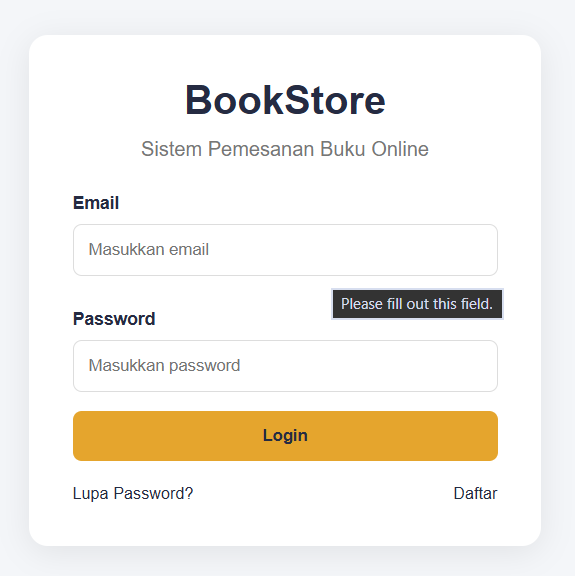
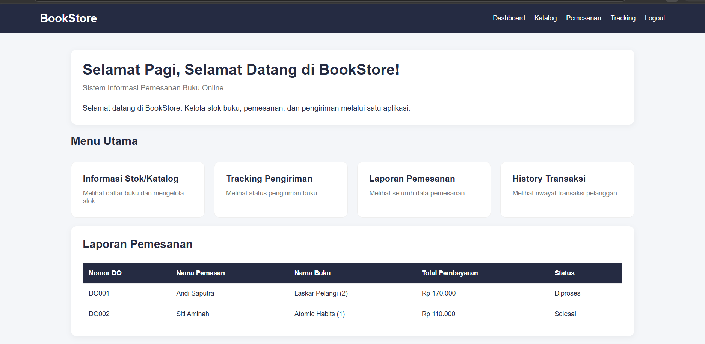
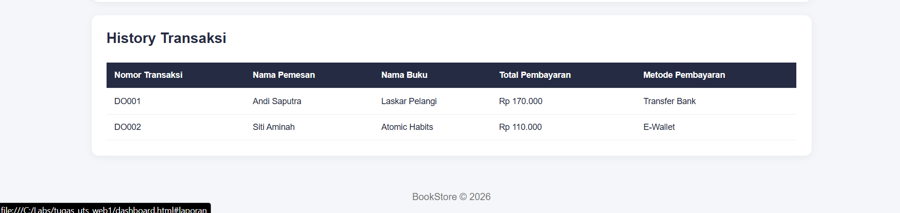
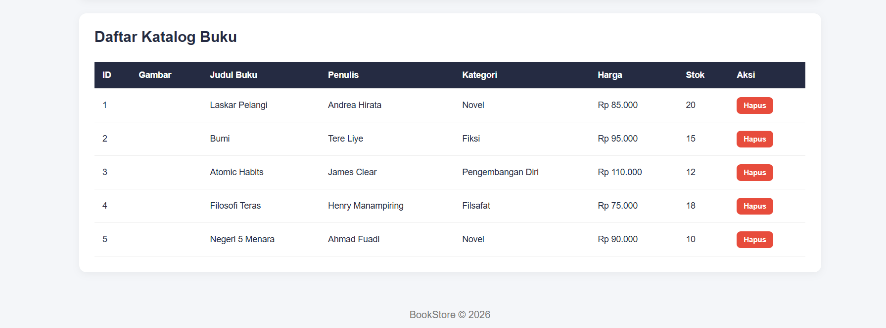
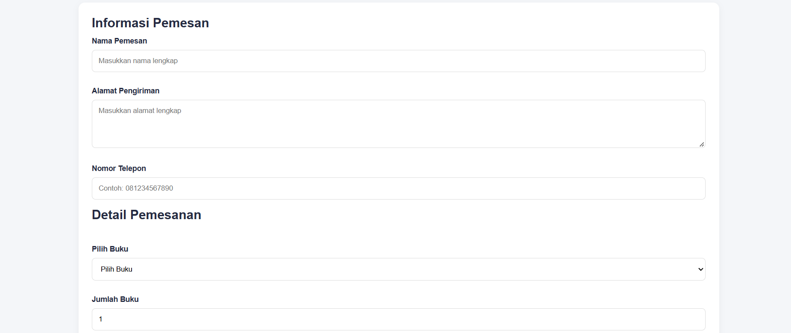
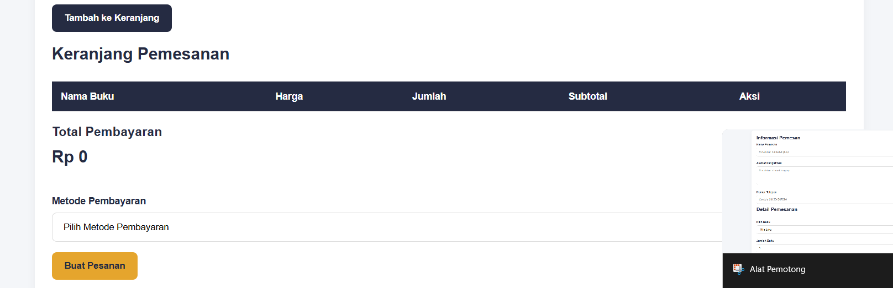
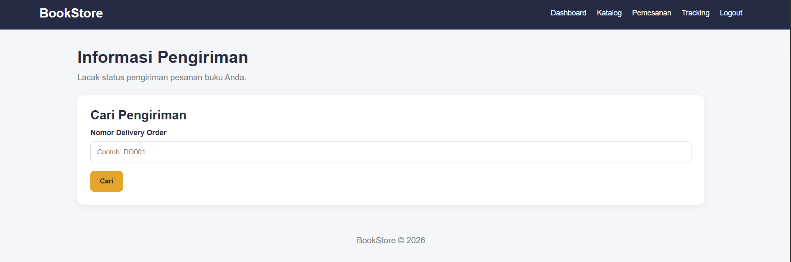

# tugas_uts_web1
# README – UTS Pemrograman Web 1
## Project BookStore

**Nama:** Miftah Ma’ruf  
**Kelas:** I253A


## menambahkan foto









---


## 1. Struktur Folder

```text
tugas-uts-web1/
├── index.html
├── dashboard.html
├── stok.html
├── checkout.html
├── tracking.html
├── css/
│   └── style.css
├── js/
│   ├── data.js
│   └── script.js
└── assets/
```

## 2. Penjelasan Kode dan Fungsinya

### Step 1 – Struktur HTML
File: `index.html`, `dashboard.html`, `stok.html`, `checkout.html`, `tracking.html`

Kode penting:
```html
<!DOCTYPE html>
<html lang="id">
<head>
    <meta charset="UTF-8">
    <title>BookStore</title>
</head>
<body>
    <!-- Isi halaman -->
</body>
</html>
```

Fungsi:
- Membuat struktur dasar halaman website.
- Menentukan bahasa dan judul halaman.
- Menyediakan tempat untuk konten website.

### Step 2 – Form Login
File: `index.html`

Kode penting:
```html
<form id="loginForm">
    <input type="email" id="email" placeholder="Email">
    <input type="password" id="password" placeholder="Password">
    <button type="submit">Login</button>
</form>
```

Fungsi:
- Menerima email dan password pengguna.
- Mengirimkan data input untuk diperiksa JavaScript.

### Step 3 – Validasi Login
File: `js/script.js`

Kode penting:
```javascript
if (email === "admin@gmail.com" && password === "12345") {
    window.location.href = "dashboard.html";
} else {
    alert("Email/password yang anda masukkan salah");
}
```

Fungsi:
- Memeriksa kecocokan email dan password.
- Mengarahkan pengguna ke dashboard jika benar.
- Menampilkan peringatan jika salah.

### Step 4 – Modal Box
File: `index.html` dan `js/script.js`

Kode penting:
```javascript
modal.style.display = "block";
```

Fungsi:
- Menampilkan pop-up lupa password atau pendaftaran.
- Memberikan interaksi tambahan pada halaman login.

### Step 5 – Dashboard dan Greeting
File: `dashboard.html` dan `js/script.js`

Kode penting:
```javascript
const jam = new Date().getHours();
```

Fungsi:
- Mengambil waktu lokal perangkat.
- Menentukan sapaan pagi, siang, atau sore.

### Step 6 – Data Katalog Buku
File: `js/data.js`

Kode penting:
```javascript
const dataKatalogBuku = [
    // Data buku
];
```

Fungsi:
- Menyimpan data dummy katalog buku.
- Menjadi sumber data untuk ditampilkan pada halaman stok.

### Step 7 – Menampilkan Katalog
File: `js/script.js`

Kode penting:
```javascript
document.getElementById("tabelStok");
```

Fungsi:
- Mengambil elemen tabel katalog.
- Menampilkan data buku menggunakan manipulasi DOM.

### Step 8 – Menambah dan Menghapus Stok
File: `js/script.js`

Kode penting:
```javascript
dataKatalogBuku.push(bukuBaru);
```

```javascript
dataKatalogBuku.splice(index, 1);
```

Fungsi:
- `push()` menambahkan data buku baru.
- `splice()` menghapus data buku berdasarkan indeks.

### Step 9 – Keranjang Belanja
File: `js/script.js`

Kode penting:
```javascript
keranjang.push(buku);
```

Fungsi:
- Menambahkan buku yang dipilih ke keranjang.
- Menyimpan daftar buku yang akan dipesan.

### Step 10 – Menghitung Total Pembayaran
File: `js/script.js`

Kode penting:
```javascript
const total = harga * jumlah;
```

Fungsi:
- Menghitung harga berdasarkan jumlah buku.
- Menentukan total pembayaran pesanan.

### Step 11 – Mengubah dan Menghapus Pesanan
File: `js/script.js`

Kode penting:
```javascript
keranjang[index].jumlah = jumlahBaru;
```

```javascript
keranjang.splice(index, 1);
```

Fungsi:
- Mengubah jumlah buku yang dipesan.
- Menghapus buku dari keranjang.

### Step 12 – Checkout
File: `checkout.html` dan `js/script.js`

Kode penting:
```javascript
localStorage.setItem("transaksi", JSON.stringify(transaksi));
```

Fungsi:
- Menyimpan data transaksi.
- Mengubah data JavaScript menjadi format JSON sebelum disimpan.

### Step 13 – Mengambil Data Transaksi
File: `js/script.js`

Kode penting:
```javascript
const transaksi = JSON.parse(
    localStorage.getItem("transaksi")
);
```

Fungsi:
- Mengambil data transaksi dari localStorage.
- Mengubah data JSON menjadi objek JavaScript.

### Step 14 – Tracking Pengiriman
File: `tracking.html` dan `js/script.js`

Kode penting:
```javascript
if (nomorDO === data.nomorDO) {
    // Tampilkan informasi pengiriman
}
```

Fungsi:
- Memeriksa nomor Delivery Order.
- Menampilkan informasi pemesan dan status pengiriman.

### Step 15 – Laporan dan Histori Transaksi
File: `js/script.js`

Fungsi:
- Menampilkan daftar transaksi yang telah dilakukan.
- Menampilkan informasi pesanan.
- Mengambil data transaksi yang tersimpan.

### Step 16 – Desain CSS
File: `css/style.css`

Kode penting:
```css
body {
    margin: 0;
    font-family: Arial, sans-serif;
}

button {
    cursor: pointer;
}
```

Fungsi:
- Mengatur tampilan dasar website.
- Mengatur jenis tulisan dan jarak halaman.
- Mengatur tampilan tombol dan komponen lainnya.

## 3. Teknologi yang Digunakan

- **HTML:** Membuat struktur halaman website.
- **CSS:** Mengatur tampilan dan desain website.
- **JavaScript:** Mengatur fungsi dan interaksi aplikasi.
- **DOM:** Memanipulasi elemen HTML.
- **Array:** Menyimpan data buku dan transaksi.
- **JSON:** Mengelola format data.
- **localStorage:** Menyimpan data di browser.

## 4. Kesimpulan

Project BookStore merupakan aplikasi pemesanan buku online sederhana yang dibuat menggunakan HTML, CSS, dan JavaScript. Project ini menerapkan struktur HTML, desain CSS, manipulasi DOM, validasi form, pengelolaan data array, serta penyimpanan transaksi menggunakan localStorage.